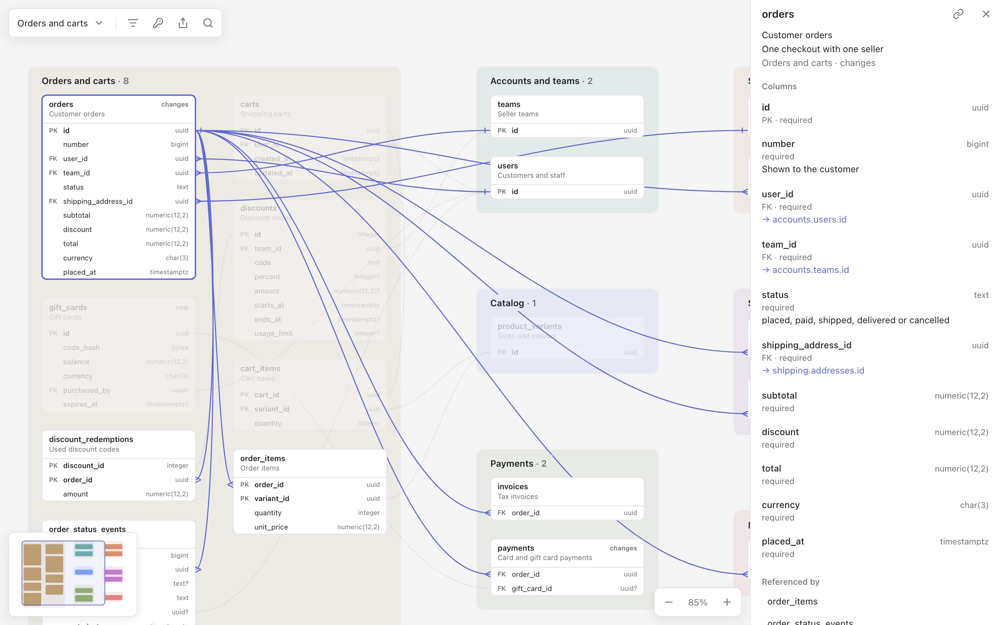

# schemap

A skill for coding agents that draws a database schema as one HTML file or a claude.ai artifact.



Sources: SQL migrations, a Postgres database, Prisma, DBML, or a written spec.

The viewer has search, a minimap, a keys-only view, a filter for new and changed tables, light and dark themes, and links to a single table. The interface is in English or Russian.

## Install

As a Claude Code plugin:

```bash
claude plugin marketplace add goodmartian/schemap
```

```bash
claude plugin install schemap@schemap
```

As a skill for other agents, via [skills.sh](https://skills.sh/):

```bash
npx skills add goodmartian/schemap -g -y
```

## Usage

Ask the agent to draw the database. The steps it follows are in [`SKILL.md`](skills/schemap/SKILL.md), the input format in [`schema-format.md`](skills/schemap/schema-format.md).

To build a page by hand:

```bash
node skills/schemap/check.mjs schema.json -o diagram.html
```

## Example

[`examples/storefront`](examples/storefront): an online store with 49 tables, 250 columns, 71 references and 8 modules.

## Requirements

- The page needs only a browser.
- `check.mjs` needs Node 18+.
- The importers in `skills/schemap/importers/` need Python 3.9+.

Tests: `python3 tests/run_checks.py`.

## What the plugin runs

- `node check.mjs` and the Python importers read local files and write `schema.json` and the page. No network.
- `psql` with `importers/postgres_schema.sql` runs one read-only query against the system catalogs of the database the user names.
- The page loads nothing from the network.
- An artifact is published to claude.ai only when the user asks for a link.

## License

MIT
