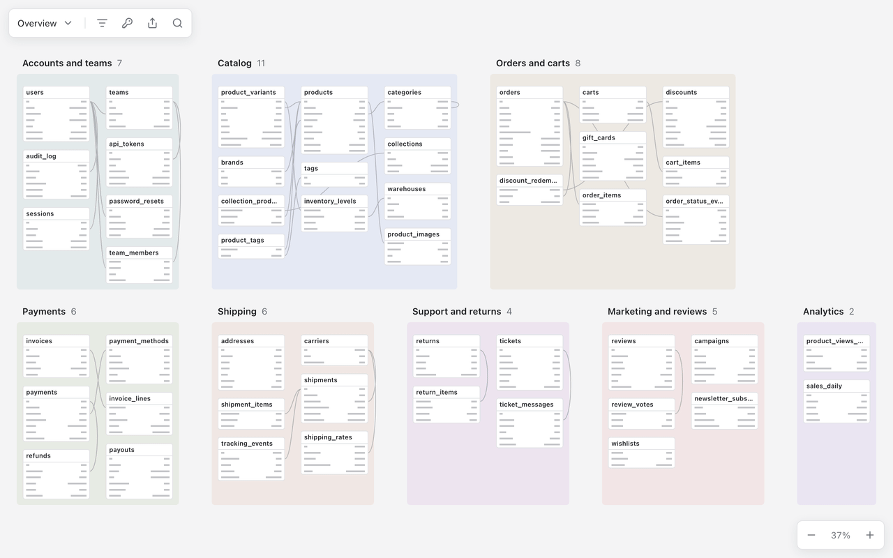

# schemap

A skill for coding agents that draws a database schema as one HTML file or a claude.ai artifact.

**[Live demo](https://goodmartian.github.io/schemap/examples/storefront/diagram.html)**: an online store with 49 tables, 250 columns, 71 references and 8 modules. Nothing to install.



What it does, how to use it and what it runs: [`plugins/schemap/README.md`](plugins/schemap/README.md).

## Install

As a Claude Code plugin:

```bash
claude plugin marketplace add goodmartian/schemap
```

```bash
claude plugin install schemap@schemap
```

As a skill for other agents, via [skills.sh](https://skills.sh/):

```bash
npx skills add goodmartian/schemap -g -y
```

## Example

The demo's source is [`examples/storefront/schema.json`](examples/storefront/schema.json); the page is [`diagram.html`](examples/storefront/diagram.html) next to it.

## Development

- Tests: `node tests/run-checks.mjs`.
- Animation for this page: `bash docs/screenshots/make_demo.sh`.

## License

MIT
