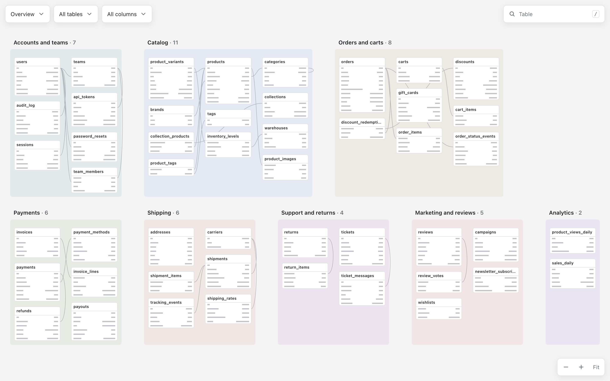
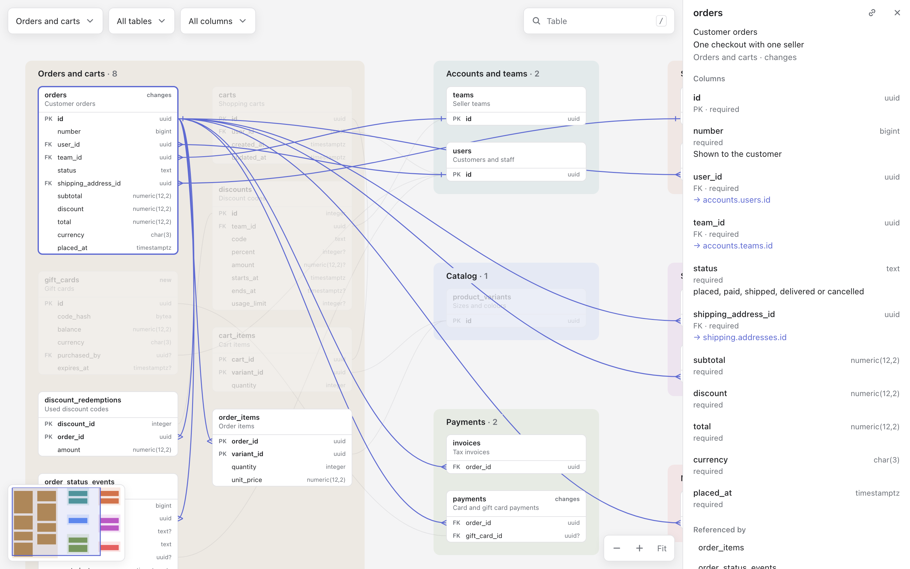
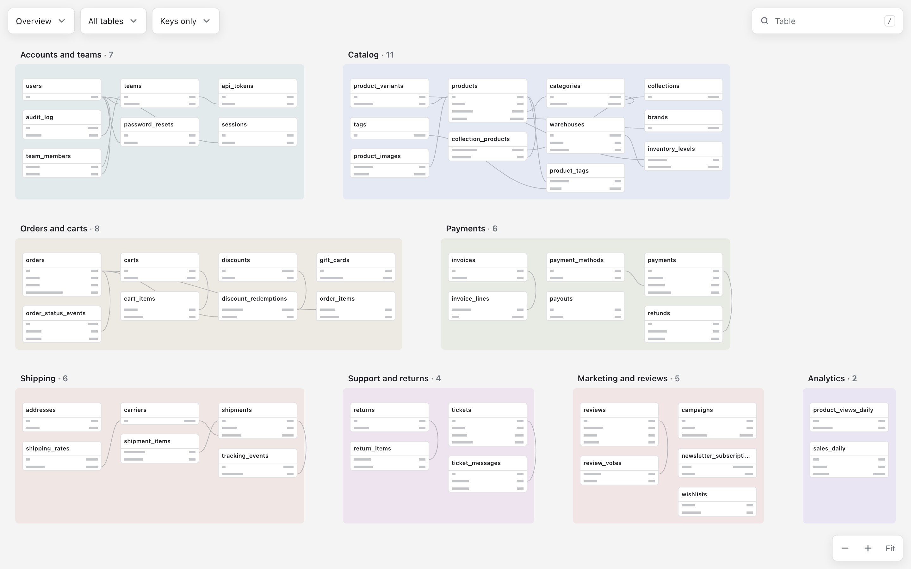
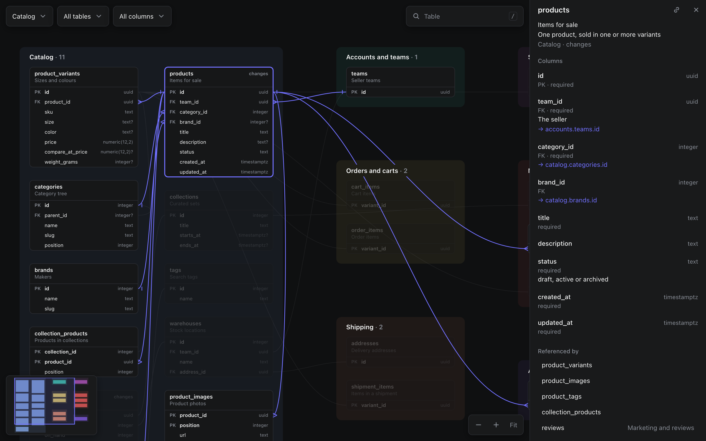

# schemap

Readable diagrams of large database schemas, made by your coding agent. Even at 200+ tables.



Ask your agent: *"draw our database"*, *"show the schema from the migrations as a diagram"*, *"make a link to the database diagram for the manager"*. It reads the schema from your project, groups the tables into modules with human names, and gives you one HTML file that opens offline, or a private claude.ai artifact link to send.

## What you get

**Click a table** to read it: its links light up across modules, with "many" and "one" at their ends, and the side panel lists every column with its note and where it points.



**Keys only** hides every column except primary keys and both ends of each reference, so a big schema fits on one screen.



**Light and dark**, following the system or the claude.ai theme.



Also: search (`/` or Cmd+K), a filter for new and changing tables when the schema marks them, a minimap, column notes on hover, and links that open the diagram on one table. The interface is in English or Russian.

## Try the example

[`examples/storefront`](examples/storefront) is a made-up online store: 49 tables, 250 columns, 71 references, 8 modules. Download [`diagram.html`](examples/storefront/diagram.html) and open it, or rebuild it from [`schema.json`](examples/storefront/schema.json):

```bash
python3 skills/schemap/scripts/build_diagram.py examples/storefront/schema.json -o diagram.html
```

## Install

As a Claude Code plugin:

```bash
claude plugin marketplace add goodmartian/schemap
```

```bash
claude plugin install schemap@schemap
```

As a skill for Claude Code, Codex, Gemini CLI, Cursor and other agents ([skills.sh](https://skills.sh/)):

```bash
npx skills add goodmartian/schemap -g -y
```

## How it works

1. **Read the schema** into `schema.json`: from SQL migrations, a live Postgres database (read-only), Prisma, DBML, or written by the agent from a spec.
2. **Shape it for the reader**: modules, human table names, column notes, and new / changing marks. This is the agent's job, guided by [`SKILL.md`](skills/schemap/SKILL.md).
3. **Build** one HTML file. The build checks the input and the layout and stops on any problem: no overlapping cards, no table outside its module.

| Path | What it does |
|---|---|
| `skills/schemap/SKILL.md` | The workflow the agent follows |
| `skills/schemap/schema-format.md` | The `schema.json` format every step shares |
| `skills/schemap/scripts/build_diagram.py` | `schema.json` → diagram, with checks of the input and the layout |
| `skills/schemap/scripts/import_sql.py`, `import_prisma.py`, `import_dbml.py` | Sources → `schema.json` |
| `skills/schemap/scripts/schema_io.py` | What the importers share: text helpers, command line, writing and checking `schema.json` |
| `skills/schemap/scripts/postgres_schema.sql` | Read-only query: a live Postgres database → `schema.json` |
| `skills/schemap/scripts/viewer.template.html` | The viewer: one canvas, no libraries |
| `tests/run_checks.py` | The three importers read the same shop identically, and everything builds |
| `docs/screenshots/make.sh` | Retakes these screenshots with headless Chrome |

Python 3.9+ only, no packages. Check a copy with `python3 tests/run_checks.py`.

## Privacy

Nothing leaves the machine unless you ask for an artifact link. Artifacts are private to your claude.ai account until you share them. The Postgres query only reads the system catalogs; connection strings never go into files.

## По-русски

schemap рисует понятную схему базы данных, даже если в ней 200 таблиц. Источник — миграции, живая база, Prisma, DBML или текст спецификации. Результат — один HTML-файл без интернета или приватная ссылка-артефакт в claude.ai. Интерфейс просмотрщика — на русском или английском (`"lang": "ru"`).

## License

MIT
